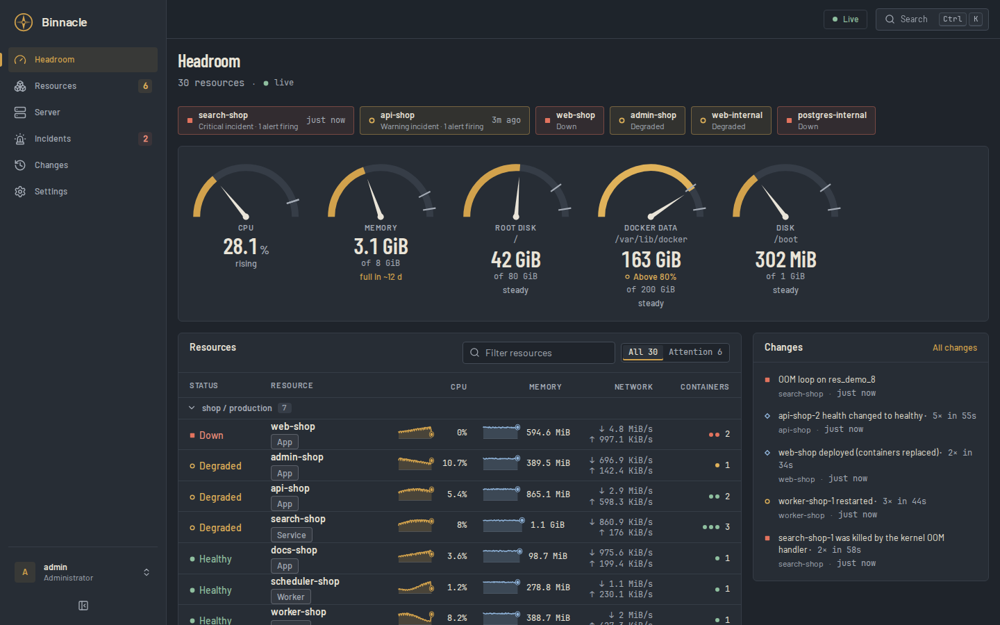
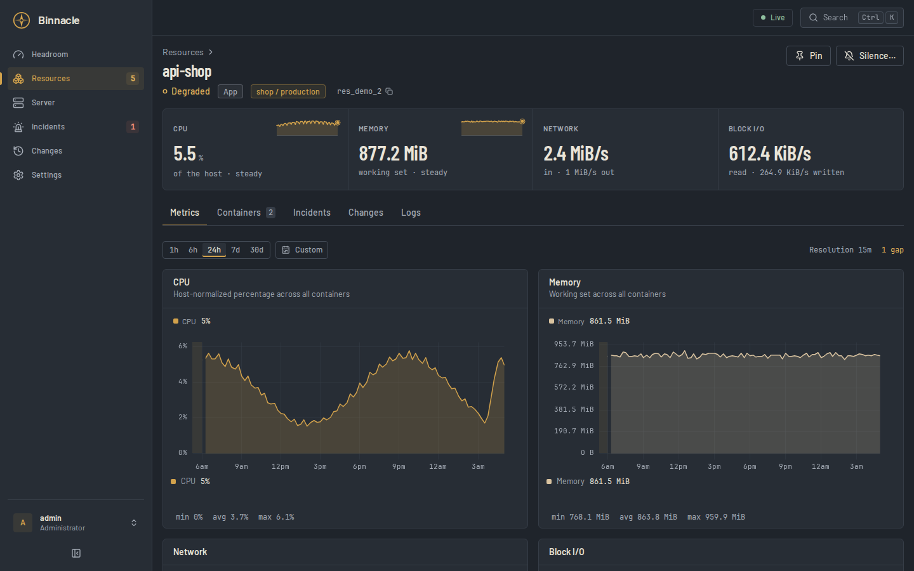
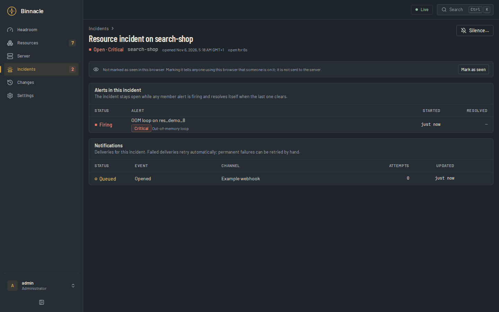
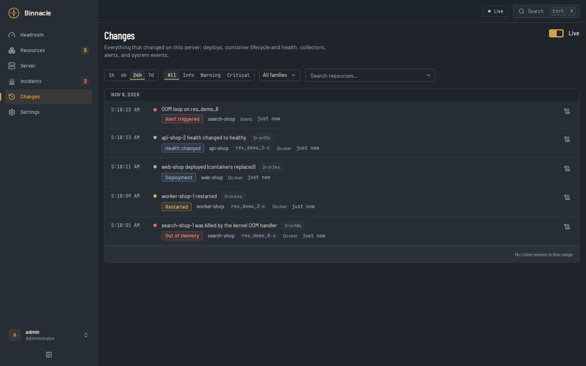
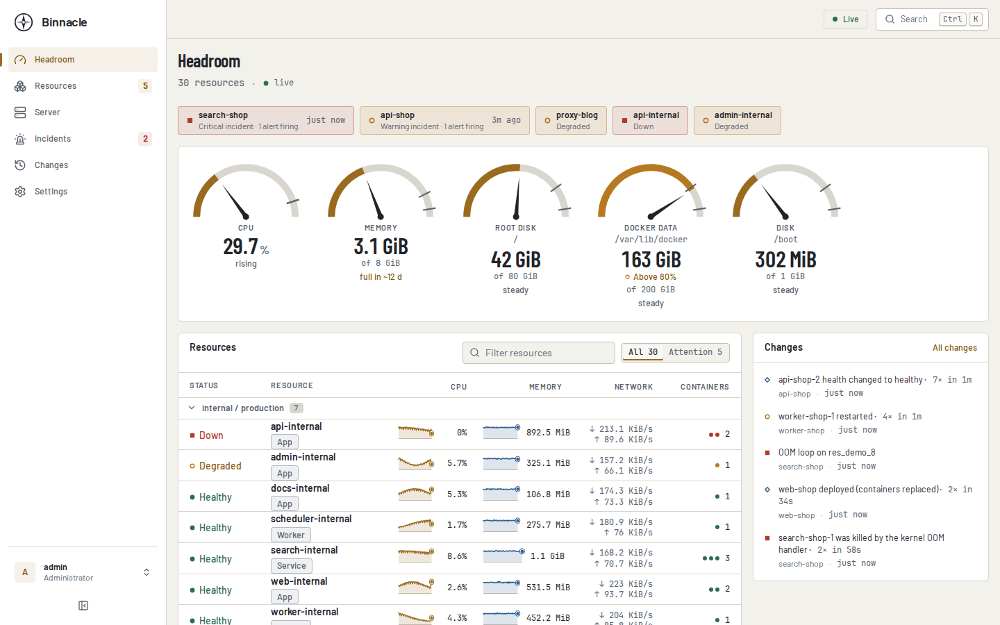

# Binnacle


> Lightweight, Coolify-aware monitoring for Docker servers.

Binnacle tells you how much room your Docker server has left and when it runs
out. It draws a gauge for CPU, memory and every disk, fits a line through the
last 24 hours of each disk and of memory, and says "full in ~12 d" before a
volume fills. Around that it shows your Coolify and Compose services with
their containers, HTTP checks, incidents with webhook and SMTP notifications,
and a log of every deploy, restart and OOM kill.

It is one Go binary with the web interface embedded and one SQLite file on the
server it watches. With 30 containers it peaks at 74 MiB of memory and 0.5 % of
one CPU core ([benchmark](docs/operations/benchmarking.md)). It sends no
telemetry and has no code path that changes a container.



| Resource detail | Incident |
| --- | --- |
|  |  |
| **Changes** | **Headroom, light theme** |
|  |  |

Screenshots are from `make dev-demo`: 30 synthetic containers with 24 hours of
seeded history.

## Status

The current stable release is v0.6.0. Advanced authentication (TOTP and
trusted-proxy authentication) and portability (personal API tokens, exports,
and Prometheus eligibility) remain disabled by default pending their acceptance
tests. Exact release tags and the `stable` container image are production
artifacts; untagged source builds are development builds. See the
[roadmap](ROADMAP.md) and [release checklist](docs/operations/release-checklist.md)
for qualification details.

## Guarantees and scope

- **Read-only permanently:** Binnacle observes hosts and Docker workloads. It
  does not restart, stop, delete, exec into, or redeploy containers.
- **Local-first:** metrics, checks, alerts, configuration, and history remain on
  the monitored server. Core operation needs no SaaS service and sends no
  telemetry by default.
- **Small deployment:** one Go process, one SQLite database, and an embedded web
  interface; queues, collection, and persistence are bounded.
- **Docker-compatible, Coolify-aware:** ordinary Docker and Compose work without
  Coolify; available metadata improves logical resource grouping.
- **Single-server:** one Binnacle instance monitors one Linux Docker server.

Supported targets are Ubuntu 22.04/24.04 and Debian 12/13 on amd64 or arm64,
with Docker Engine 29.5.1 or newer. Coolify is the primary deployment path and
Docker Compose is the portable alternative. Kubernetes, Podman, non-Linux
hosts, and workload control are unsupported.

## Quick start

For production installation with the published `v0.6.0` image, follow the
[installation guide](docs/operations/install.md). To evaluate Binnacle locally
with synthetic data:

```bash
git clone https://github.com/drilonrecica/binnacle.git
cd binnacle
make dev-demo
```

Open `http://127.0.0.1:8080` and complete setup. This uses a fresh temporary
database on each run.

> **Docker socket warning:** a Docker socket is privileged even when its
> filesystem mount is read-only. Binnacle contains no mutation paths, but a
> compromised process with socket access may control Docker. Prefer a
> constrained read-only socket proxy where practical; see [Security](SECURITY.md).

## Development

The supported local entry points are:

```bash
make dev-demo       # application with deterministic synthetic data
make dev-host       # application against the local host and Docker engine
make check          # formatting, static checks, and test suite
make build          # production binary and embedded frontend
make test           # Go and frontend unit tests
```

Frontend end-to-end suites require Playwright and are documented by
`make help`. Release qualification uses `./scripts/release-gate.sh`.

## Documentation

- [Product boundaries and guarantees](docs/PRODUCT.md)
- [Roadmap](ROADMAP.md)
- [Checks and alerts](docs/CHECKS_AND_ALERTS.md)
- [Incidents and notifications](docs/INCIDENTS_AND_NOTIFICATIONS.md)
- [Logs and process diagnostics](docs/DIAGNOSTICS.md)
- [Coolify enrichment and administrator access](docs/COOLIFY_AND_ACCESS.md)
- [API tokens, exports, Prometheus, and personalization](docs/INTEROPERABILITY.md)
- [Installation](docs/operations/install.md), [upgrades](docs/operations/upgrade.md), and [recovery](docs/operations/recovery.md)
- [Security policy](SECURITY.md)
- [Contributing guide](CONTRIBUTING.md) and [governance](GOVERNANCE.md)
- [Architecture decision records](adr/)

## License

Binnacle is licensed under [AGPL-3.0-only](LICENSE). Network users of a modified
version must be offered its corresponding source as required by the license.
The license does not grant rights to the Binnacle name or logo.
